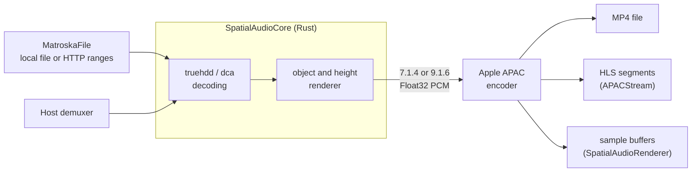

# Architecture

SpatialAudioBridge converts one compressed TrueHD Atmos or DTS:X track into APAC, so Apple TV plays it through its native spatial audio path. This page covers how the pieces fit together and why the timing lines up. The [integration guide](integration.md) covers how to use them.

## Pipeline

1. **Source.** `MatroskaFile` reads the selected track's frames from an MKV, locally or through HTTP range requests, and seeks with the file's cues. Hosts with their own demuxer pass the compressed payloads directly.
2. **Decode and render** (Rust, `SpatialAudioCore`). [truehdd](https://github.com/truehdd/truehdd) decodes TrueHD and its Atmos object metadata. [dca](https://github.com/harletty/harletty-bridge/tree/a717bae441b116485f0254603dc20a6ede65d8c6/dca) decodes DTS-HD and the DTS:X height presentation. The renderer places objects and heights on 7.1.4 or 9.1.6 speakers, as described in the [rendering model](rendering.md). Unsupported metadata fails the session rather than rendering incorrectly.
3. **Encode** (Swift). Apple's encoder compresses the speaker feeds as channel-based APAC, profile 31: level 3 for 12 channels, level 4 for 16.
4. **Deliver.** The encoded audio is written as an MP4 file, fragmented MP4 for HLS, or sample buffers for `AVSampleBufferAudioRenderer`.

The original bitstream and object stream are not preserved: objects are rendered to speakers, then APAC encodes those channels lossily.

## Products

| Product | Contents | Links the Rust core |
|---|---|---|
| `SpatialAudioBridge` | Decoding, rendering, encoding, Matroska reading, `APACStream`, `SpatialAudioRenderer` | Yes |
| `SpatialAudioPlayback` | `AtmosOutputActivator` | No |
| `apac-convert` | Command-line converter built on the public API | Yes |

`scripts/build-core.sh` builds the Rust core as an XCFramework for Apple Silicon Macs, Apple TV devices and the Apple TV simulator.

## Output paths

| | `APACStream` | `SpatialAudioRenderer` | `SpatialAudioTranscoder` |
|---|---|---|---|
| Plays through | `AVPlayer` | `AVSampleBufferAudioRenderer` | Host's choice |
| Encoder | `AVAssetWriter`, live profile | `AudioConverter`, live profile | `AVAssetWriter`, offline profile by default |
| Seeks | Converts the requested segment on demand | Host calls `begin(at:)` | Host starts a new session |
| Host owns | Video playlist, `AVPlayer` | Synchronizer, video, demuxing | Everything around the bytes |

`APACStream` is assembled from parts the library exposes: a `MatroskaFile`, one `SpatialAudioTranscoder` per conversion run with a segment destination, playlists and a loopback HTTP server. Hosts with different needs can build their own arrangement from the same parts.

## Timing

### Encoder priming

The APAC encoder emits 2048 leading frames (42.7 ms) of priming before the first source sample. `APACConfiguration.encoderPrimingDuration()` queries the installed encoder instead of assuming that value. MP4 files trim the priming from their presented duration. Fragmented MP4 keeps it in the coded timeline: a session started at `startTime` T writes its first fragment at T − priming, and the decoder discards the priming frames. A session starting at zero cannot place priming before zero, so its audio is late by the priming duration. Start at a time of at least the priming duration when that matters.

### The segment grid

`APACStream` divides the timeline into segments of exactly two APAC sync periods: 2 × 75 packets × 1024 frames = 153,600 frames, or 3.2 s at 48 kHz. Segment N always covers N × 3.2 s up to (N + 1) × 3.2 s, whichever conversion run produced it.

To produce segment N, a run asks `MatroskaFile` for packets from the last sync point before N × 3.2 s + priming, discards decoded audio before that time, and starts the encoder there. The first fragment then begins exactly at N × 3.2 s, its priming occupying the first 42.7 ms. Every following fragment continues on the grid. This makes the following true:

- All runs share one initialization segment, so AVPlayer can mix segments from different runs.
- A run started by a seek produces the same timestamps as a run that played through. In the fixture test, the restarted segment's audio matches the continuous one with a correlation above 0.99 after the priming.
- The first segment of a restarted run carries 42.7 ms of priming in place of source audio. AVPlayer plays it after a seek, where a short gap is expected. Continuous playback only crosses a restart when a request falls outside the converted range.

### Live and offline encoding

Apple's encoder supports dynamic-range configurations with different lookahead. The configuration, not the content source, set the latency measured on macOS 27.0.1:

| Configuration | First fragment after | Later fragments trail input by |
|---|---|---|
| Movie (offline, the transcoder's default) | 23.3 s of input | about 20 s |
| Capture (live, `liveEncoding: true`) | 4.8 s of input | about 1.6 s |

A player cannot wait 23 s for a seek, so `APACStream` and `SpatialAudioRenderer` always encode live, with Apple's spatial live content source. File conversion keeps the offline Movie profile, which Apple designed for finished films. The two profiles may differ in loudness and dynamic-range processing; compare by listening when that matters.

`SpatialAudioRenderer` drives `AudioConverter` directly, which requires `AudioConverterFillComplexBufferWithPacketDependencies` for APAC. Its live encoder holds about 71 packets (1.5 s) before the first output. Pausing the input works only with the live configuration.

## Concurrency, bounds and failure

- `SpatialAudioTranscoder` and `SpatialAudioRenderer` are actors. They accept one operation at a time and suspend the caller while the asset writer or audio renderer is full, so memory stays bounded however fast the source delivers.
- `APACStream` converts one run at a time in steady playback, paced to `lookahead` segments (default 6, or 19.2 s) ahead of the newest request. After a restart, once the first run has delivered its first segment, a helper run converts from 5 segments ahead in parallel, paced from its own start, until the first run reaches it and hands over. Starting both at once delayed that first segment past the 3 s `AVPlayer` allows a seek on Apple TV. The stream keeps segments from `keptBehind` (default 20) before the newest request up to the helper's start plus lookahead + 2: at most 34 segments, about 56 MB at the default 9.1.6 bit rate.
- The encoder runs on one thread per run, so the helper splits the conversion `AVPlayer` waits for after a seek, about 12 segments in order on the tested title, between two threads. A helper starts one segment early and discards that fragment, because a run's first fragment carries 42.7 ms of priming instead of source audio, which would be audible where the first run's audio plays on into the helper's.
- A request waits for the current run only if the run will reach it within about two segments; otherwise it restarts conversion there, since a new run delivers its first segment in about two segments' conversion time. A request that a later restart superseded is answered with status 503 at once.
- Every decoding, encoding or callback failure ends its session. `APACStream` reports a failed run to the waiting segment request as an HTTP error and starts a new run on the next request. Task cancellation stops conversion.
- The Matroska reader fetches the file in 2 MiB windows and reads clusters in order, so a remote file's video bytes are transferred too. On a local network this costs about the file's bitrate.

## Where the time goes

Apple's APAC encoder was about 85% of the conversion work in a macOS profile; TrueHD decoding and rendering were small by comparison. `AVAssetWriter` runs the encoder on one thread per session, at about 3.2 times real time on Apple TV 4K (2nd generation) for 9.1.6, in Debug and Release builds alike. Every path encodes at the medium quality tier, Core Audio's default. `AVAssetWriter` ignores the quality setting for APAC, but its packets were bit-identical to `AudioConverter` at medium, and `SpatialAudioRenderer` sets medium explicitly. Medium matched the high tier on real Atmos content at less CPU, so the quality setting offers no faster encoding without losing quality.

## Boundaries

The host keeps video, track selection, subtitles, the player UI and its fallback for unsupported tracks. The library rejects what it cannot render correctly, including Atmos objects outside the room, bed downmix metadata, multiple beds and unrecognized DTS:X presentations, so the host can fall back to its existing audio path. The [current support table](../README.md#current-support) lists the details.
