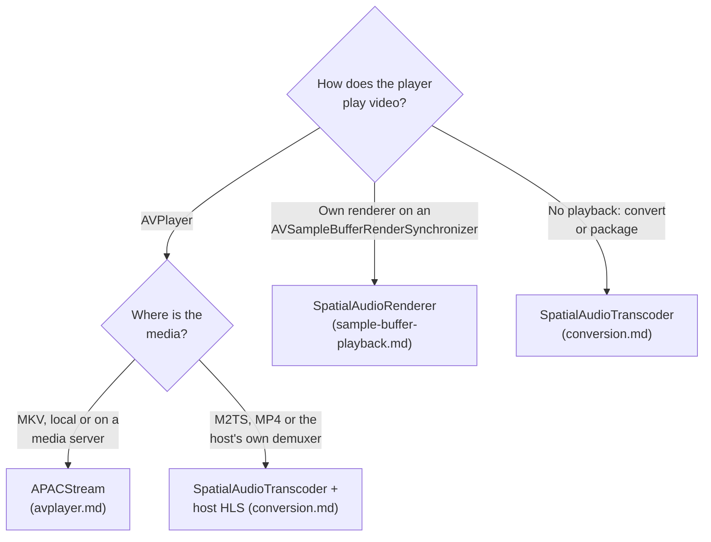

# Integration guide

SpatialAudioBridge plays TrueHD Atmos and DTS:X tracks through Apple's native spatial audio path by converting them to APAC. This page helps choose an integration path and lists what the host keeps. Each path has its own guide.

## Choose a path

| Path | Guide | Host provides | Library provides |
|---|---|---|---|
| `APACStream` | [Play through AVPlayer](avplayer.md) | File URL, video HLS master, `AVPlayer` | Matroska reading, on-demand conversion, playlists, loopback server, seeking |
| `SpatialAudioRenderer` | [Play through sample buffers](sample-buffer-playback.md) | Packets, synchronizer, video rendering | Conversion into a queued `AVSampleBufferAudioRenderer` |
| `SpatialAudioTranscoder` | [Convert and package](conversion.md) | Packets or an elementary stream; serving and playlists | Conversion to MP4 files or fragments |

Every playback path also needs [`AtmosOutputActivator`](atmos-output.md) to switch the receiver to Atmos. [Media servers](media-servers.md) covers Jellyfin URLs, and [troubleshooting](troubleshooting.md) covers common failures.

## What the host keeps

- **Selection and fallback.** The host decides which track plays. Convert only TrueHD Atmos and DTS:X tracks, and play everything else through the existing path. When the library throws, fall back to that path as well: it rejects metadata it cannot render rather than playing it wrongly.
- **Video, subtitles and UI.** `APACStream` passes the server's video and subtitle renditions through unchanged. `SpatialAudioRenderer` leaves video entirely to the host.
- **A native audio route.** APAC needs Apple's playback stack: `AVPlayer` or `AVSampleBufferAudioRenderer`. A software PCM output, as in VLC or mpv, cannot carry it.
- **Lifecycle.** Stop the stream or renderer when playback ends or the item changes, and detach the activator.

## Fit with existing players

None of the surveyed open-source Apple TV players hand compressed audio packets to the app:

| Player | Engine | Integration |
|---|---|---|
| Swiftfin | VLC by default; native `AVPlayer` option | `APACStream` in the native player, with Jellyfin URLs |
| Streamyfin, Yattee | mpv | A native `AVPlayer` route for these tracks, or an mpv hook that hands packets to `SpatialAudioRenderer` |
| VLC for tvOS | libVLC | Requires patching libVLC for packet access |
| KSPlayer | FFmpeg, closed core | Needs vendor support for packet access |

For players that switch engines per item, routing TrueHD Atmos and DTS:X items to an `AVPlayer` with `APACStream` is the least invasive option. React Native apps can wrap either path in their native playback module; the public API exchanges only URLs, data, times and configuration.

## Requirements

- tvOS 26 or macOS 26 for encoding. Apps supporting older systems need availability checks and their existing audio path on those systems.
- The Rust core is built locally as an XCFramework with `scripts/build-core.sh`; add this checkout as a local Swift package. A checksummed binary release is planned.
- Ship the [license notices](../THIRD-PARTY-NOTICES.md) of the decoder dependencies with binary distributions.

## Timing rules

These apply whenever the host assembles its own presentation:

- Start a new session after a seek, timestamp discontinuity or format change. Begin at a decodable sync point and pass its container time as `inputStartTime`.
- Set `startTime` to the first audio presentation time. Output advances by decoded samples, without drift.
- Fragmented output keeps 2048 frames (42.7 ms) of encoder priming before `startTime`. Query `encoderPrimingDuration()` instead of hardcoding it.
- Coded fragment durations include priming; the conversion report counts source frames. They are different quantities.

[Architecture](architecture.md#timing) explains how `APACStream` uses these rules to keep segments from different conversion runs on one timeline.
