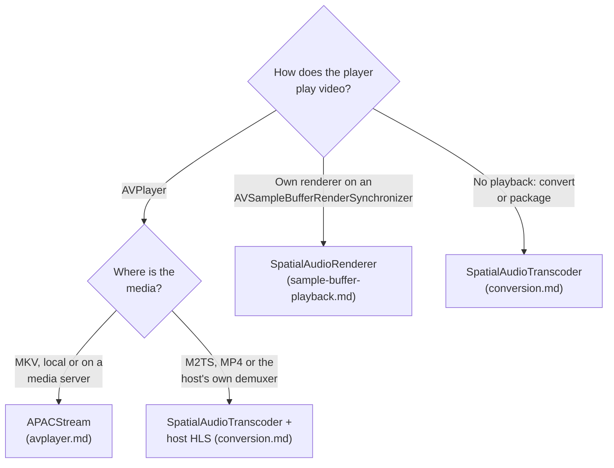

# Integration guide

SpatialAudioBridge plays TrueHD Atmos and DTS:X tracks through Apple's native spatial audio path by converting them to APAC. This page helps choose an integration path and lists what the host keeps. Each path has its own guide.

## Choose a path

| Path | Guide | Host provides | Library provides |
|---|---|---|---|
| `APACStream` | [Play through AVPlayer](avplayer.md) | File URL, video HLS master, `AVPlayer` | Matroska reading, on-demand conversion, playlists, loopback server, seeking |
| `SpatialAudioRenderer` | [Play through sample buffers](sample-buffer-playback.md) | Packets, synchronizer, video rendering | Conversion into a queued `AVSampleBufferAudioRenderer` |
| `SpatialAudioTranscoder` | [Convert and package](conversion.md) | Packets or an elementary stream; serving and playlists | Conversion to MP4 files or fragments |

Every playback path also needs [`AtmosOutputActivator`](atmos-output.md) to switch the receiver to Atmos. [Media servers](media-servers.md) covers Jellyfin URLs, and [troubleshooting](troubleshooting.md) covers common failures.

## What the host keeps

- **Selection and fallback.** The host decides which track plays. Convert only TrueHD Atmos and DTS:X tracks, and play everything else through the existing path. When the library throws, fall back to that path as well: it rejects metadata it cannot render rather than playing it wrongly.
- **Let the library recognise DTS:X.** FFmpeg and Jellyfin report alternate DTS:X presentations as plain `DTS-HD MA`, so choosing by their `DTS-HD MA + DTS:X` profile leaves those tracks on the old path. Offer every TrueHD and DTS-HD MA track instead. A session verifies Atmos or DTS:X as soon as decoding starts and throws for plain TrueHD or DTS-HD MA, so the host falls back before playback; see [troubleshooting](troubleshooting.md#apacstreamstart-or-a-session-throws).
- **Video, subtitles and UI.** `APACStream` passes the server's video renditions through unchanged, and its subtitle renditions with their WebVTT timing moved onto the video's timeline. `SpatialAudioRenderer` leaves video entirely to the host.
- **A native audio route.** APAC needs Apple's playback stack: `AVPlayer` or `AVSampleBufferAudioRenderer`. A software PCM output, as in VLC or mpv, cannot carry it.
- **Lifecycle.** Stop the stream or renderer when playback ends or the item changes, and detach the activator.

## Fit with existing players

Some open-source Apple TV players read the file on the device and hand `AVPlayer` a loopback HLS stream, so they already hold the compressed packets. They convert TrueHD and DTS to E-AC-3 5.1 or FLAC, which drops the objects. The others leave demuxing to the server or to an engine that decodes to PCM.

| Player | Engine | Integration |
|---|---|---|
| [AetherEngine](https://github.com/superuser404notfound/AetherEngine), and [Sodalite](https://github.com/superuser404notfound/Sodalite) on it | FFmpeg demux into loopback HLS for `AVPlayer`; TrueHD and DTS become E-AC-3 5.1 or FLAC | Feed the packets to `SpatialAudioTranscoder` and serve the APAC segments as the HLS audio |
| [Tomo TV](https://github.com/keiver/tomotv) | Its own FFmpeg engine, into loopback HLS for `AVPlayer`; TrueHD and DTS become FLAC | The same, in its engine |
| [Lumen](https://github.com/joaoalvess/lumen-player) | KSPlayer, with an MKV remux into loopback HLS for `AVPlayer`; TrueHD and DTS become FLAC | The same, in its remux engine |
| [Swiftfin](https://github.com/jellyfin/Swiftfin), and its fork [Reefy](https://github.com/jmhunter83/reefy) | VLC by default; native `AVPlayer` option | `APACStream` in the native player, with Jellyfin URLs |
| [Stingray](https://github.com/benjaminRoberts01375/Stingray) | `AVPlayer` with Jellyfin's HLS | `APACStream` with Jellyfin URLs |
| [Streamyfin](https://github.com/streamyfin/streamyfin), Yattee | mpv | An mpv audio output that passes its passthrough bursts through `IEC61937Unpacker` to `SpatialAudioRenderer`, keeping mpv's video, subtitles and UI; or a native `AVPlayer` route for these tracks |
| VLC for tvOS | libVLC | Requires patching libVLC for packet access |
| KSPlayer | FFmpeg, closed core | Needs vendor support for packet access |

The engines that remux on the device fit best: they work with any server that serves the original file, and only their audio conversion step changes. Segments from a [`.segments`](conversion.md#write-hls) destination start with an APAC sync packet; after a seek, start a new session on the same segment grid, as [`APACStream` does](architecture.md#the-segment-grid). For MKV, `APACStream` given the engine's loopback video playlist is a shortcut, at the cost of reading the file twice.

For players that switch engines per item, routing TrueHD Atmos and DTS:X items to an `AVPlayer` with `APACStream` is the least invasive option. Route by the server's Atmos or DTS:X label there: sending every lossless track would move plain TrueHD and DTS-HD MA from the other engine's lossless decode to the server's lossy fallback whenever the library refuses them. The cost is that alternate DTS:X presentations labelled plain `DTS-HD MA` stay on the other engine; none appeared among the DTS:X titles in the library census. React Native apps can wrap either path in their native playback module; the public API exchanges only URLs, data, times and configuration.

## Requirements

- tvOS 26, iOS 26 or macOS 26 for the API. The package builds back to tvOS and iOS 13 and macOS 10.15, so an app that supports older systems can depend on it unconditionally: wrap its use in `if #available(tvOS 26, iOS 26, macOS 26, *)` and keep the existing audio path otherwise.
- The core is universal (arm64 and x86_64) for Macs and the iOS simulator, and arm64 for Apple TV, iPhone, iPad and the Apple TV simulator. A package that also builds for visionOS or Mac Catalyst limits the dependency with `condition: .when(platforms: [.tvOS, .iOS, .macOS])`. Generic Apple TV simulator builds, which add x86_64, need `ARCHS=arm64`: Rust has no stable x86_64 tvOS simulator target. iPhone and iPad builds link but are untested.
- Depend on a release tag: it downloads the Rust core as a checksummed XCFramework. The `main` branch builds the core with `scripts/build-core.sh` instead; see [build from source](../README.md#build-from-source).
- Show `SpatialAudioBridgeNotices.text` in the app's acknowledgements. It holds SpatialAudioBridge's license and the notices of the Rust components and Rust standard library in its core, as one plain text with each license text listed once, and it is available on every system the package builds for. [THIRD-PARTY-NOTICES.md](../THIRD-PARTY-NOTICES.md) explains where it comes from.

## Timing rules

These apply whenever the host assembles its own presentation:

- Start a new session after a seek, timestamp discontinuity or format change. Begin at a decodable sync point and pass its container time as `inputStartTime`.
- Set `startTime` to the first audio presentation time. Output advances by decoded samples, without drift.
- Fragmented output keeps 2048 frames (42.7 ms) of encoder priming before `startTime`. Query `encoderPrimingDuration()` instead of hardcoding it.
- Coded fragment durations include priming; the conversion report counts source frames. They are different quantities.

[Architecture](architecture.md#timing) explains how `APACStream` uses these rules to keep segments from different conversion runs on one timeline.
